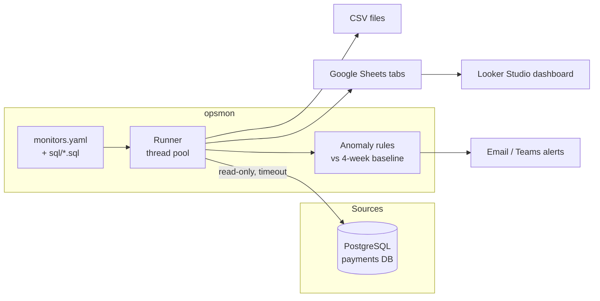

# Payments Ops Monitoring

[](https://github.com/NurMohammad126641/payments-ops-monitoring/actions/workflows/ci.yml)


**Config-driven monitoring for a digital-payments platform.** SQL metrics are pulled from
PostgreSQL in parallel, published to Google Sheets for a Looker Studio dashboard, and compared
against a 4-week baseline so that spikes in failed transactions raise an alert before customers
notice.

> **Where this comes from:** I built the original system at TallyKhata (Progoti Systems) to watch
> money-in and money-out across bKash, Nagad, Rocket, NPSB and card rails. It fed the
> dashboards that operations, support and engineering used every day. This repository is a clean,
> public rewrite: same architecture and ideas, **synthetic demo data only**, and every connection
> detail and credential comes from environment variables.

## What it does

| | |
|---|---|
| **Monitors** | Each monitor is a `.sql` file plus a few lines of YAML. Results are written to a sheet tab (or a CSV file locally). |
| **Parallel and isolated** | Monitors run concurrently. A slow or failing query is reported but never stops the others. |
| **Read-only by design** | Every session is `default_transaction_read_only` with a statement timeout, so a monitor cannot hurt the production database. |
| **Anomaly detection** | Compares the last hour with the same hour over the previous 28 days. It flags *warning* at 1.5x and *critical* at 3x, and ignores tiny counts. |
| **Alerting** | Console, SMTP email and Microsoft Teams webhooks. Each channel is enabled only when its variables are set, and one broken channel never silences the rest. |
| **Run summary** | A per-monitor timing table, plus an exit code that schedulers (cron, systemd, Airflow) can act on. |

## Architecture



## Quick start (about 2 minutes)

```bash
git clone https://github.com/NurMohammad126641/payments-ops-monitoring.git
cd payments-ops-monitoring

docker compose up -d db          # PostgreSQL with 30 days of synthetic transactions
cp .env.example .env             # points at the demo database
pip install -e ".[dev]"

opsmon list                      # show monitors and anomaly rules
opsmon run --sink csv --out out  # write every monitor to out/*.csv
```

The seed data contains a deliberate incident (ROCKET gateway timeouts in the last hour). This is
the real output of the CI integration job:

```text
monitor                 status  rows    seconds
failure_reasons_hourly  ok      91         0.04
money_flow_daily        ok      930        0.33
money_flow_hourly       ok      199        0.05
provider_success_rate   ok      5          0.03
total                                      0.44
[CRITICAL] not_success_spike / ROCKET: 152 now vs 2.1 usual (72.0x)
```

Row counts vary with the random seed and the time of day. Each CI run uploads the generated CSVs
as the `sample-output` artifact.

## Publishing to Google Sheets and Looker Studio

1. Create a Google Cloud service account, enable the Sheets API and download its JSON key into
   `secrets/` (this folder is git-ignored).
2. Share the target spreadsheet with the service account's email address (Editor).
3. Set `GOOGLE_SHEETS_SPREADSHEET_ID` and `GOOGLE_APPLICATION_CREDENTIALS` in `.env`.
4. Install the extra and run:

```bash
pip install -e ".[sheets]"
opsmon run --sink sheets
```

5. In Looker Studio, add the spreadsheet as a data source. One tab becomes one table or chart.

A service account is used instead of a personal OAuth token. Nothing expires, no browser login is
needed on the server, and access is limited to the sheets you share with it.

## Adding a monitor

1. Write the query in `sql/my_metric.sql`.
2. Register it in `config/monitors.yaml`:

```yaml
monitors:
  - name: my_metric
    title: What this shows
    source: payments
    query: my_metric.sql
    tab: my_metric
```

An anomaly rule is the same, except its query returns `key, current_count, baseline_avg`. It can
also set `ratio` (default 1.5) and `min_count` (default 20).

## Configuration

All settings are environment variables (see [`.env.example`](.env.example)):

| Variable | Purpose |
|---|---|
| `PAYMENTS_DB_URL` | DSN for the `payments` source. Add one variable per source. |
| `GOOGLE_SHEETS_SPREADSHEET_ID`, `GOOGLE_APPLICATION_CREDENTIALS` | Google Sheets sink |
| `SMTP_HOST`, `SMTP_PORT`, `SMTP_USER`, `SMTP_PASSWORD`, `ALERT_EMAIL_FROM`, `ALERT_EMAIL_TO` | Email alerts |
| `TEAMS_WEBHOOK_URL` | Microsoft Teams alerts |
| `LOG_LEVEL` | `INFO` by default |

## Project layout

```text
config/monitors.yaml    monitor and anomaly-rule definitions
sql/                    one query per metric
src/opsmon/
  cli.py                `opsmon list` / `opsmon run`
  config.py             YAML loading and validation
  db.py                 read-only PostgreSQL access (psycopg 3)
  runner.py             parallel execution, failure isolation, summary
  anomaly.py            baseline comparison (pure Python, unit tested)
  sinks.py              Google Sheets, CSV and in-memory sinks
  alerts.py             console, email and Teams channels
demo/init/              demo schema and synthetic seed data
tests/                  unit tests + PostgreSQL integration tests
```

## Testing

```bash
pytest                    # unit tests, no database needed
pytest -m integration     # needs the demo database and PAYMENTS_DB_URL
ruff check .
```

GitHub Actions runs lint and unit tests on Python 3.10 and 3.12, and an integration job
against a real PostgreSQL 16 service. A [gitleaks](https://github.com/gitleaks/gitleaks) secret
scan runs on every push.

## Results in production

- Visibility into transaction and financial KPIs improved by about **80%**, by replacing manual
  queries with one dashboard.
- Downtime went down by about **40%**, because failures were caught early through
  threshold-based alerts.

## Tech stack

Python · PostgreSQL · psycopg 3 · Google Sheets API · Looker Studio · SMTP · Microsoft Teams
webhooks · pytest · GitHub Actions · Docker

## Author

**Nur Mohammad Siddiq**, Data, BI & Automation Engineer.
[LinkedIn](https://www.linkedin.com/in/nur-mohammad-siddiq-9a73931b6) · [GitHub](https://github.com/NurMohammad126641)
